# Manual Completo do Sistema — HCR Corretora de Seguros

Bem-vindo ao **Manual Operacional e Técnico do Sistema HCR Corretora de Seguros**. Este documento apresenta o guia passo a passo de utilização de todos os módulos da aplicação web (**React 18 + Vite + Tailwind CSS**) integrada ao back-end (**Java 21 + Spring Boot 3**) e ao banco de dados relacional (**PostgreSQL 16**).

Todas as capturas de tela abaixo foram geradas de forma automatizada em resolução Full HD (`1920x1080`) diretamente a partir dos contêineres ativos do sistema, utilizando anotações precisas via DOM (`bounding_box`) com **efeito de lupa (Zoom Callout)** e **linha indicadora em vermelho (`#FF0000`)**.

---

## Sumário

1. [Visão Geral da Arquitetura e Perfis de Acesso](#1-visão-geral-da-arquitetura-e-perfis-de-acesso)
2. [Credenciais de Homologação e Apresentação](#2-credenciais-de-homologação-e-apresentação)
3. [Passo a Passo Operacional do Sistema](#3-passo-a-passo-operacional-do-sistema)
   - [Passo 01 — Autenticação e Login no Sistema (JWT)](#passo-01--autenticação-e-login-no-sistema-jwt)
   - [Passo 02 — Painel Principal (Dashboard Operacional)](#passo-02--painel-principal-dashboard-operacional)
   - [Passo 03 — Módulo de Clientes (Busca, Filtros PF/PJ e Listagem)](#passo-03--módulo-de-clientes-busca-filtros-pfpj-e-listagem)
   - [Passo 04 — Cadastro de Novo Cliente (PF ou PJ)](#passo-04--cadastro-de-novo-cliente-pf-ou-pj)
   - [Passo 05 — Histórico Completo do Cliente (Visão 360°)](#passo-05--histórico-completo-do-cliente-visão-360)
   - [Passo 06 — Módulo de Apólices e Contratos](#passo-06--módulo-de-apólices-e-contratos)
   - [Passo 07 — Registro de Contratação e Emissão de Apólice](#passo-07--registro-de-contratação-e-emissão-de-apólice)
   - [Passo 08 — Gestão de Parcelas e Baixa de Pagamentos](#passo-08--gestão-de-parcelas-e-baixa-de-pagamentos)
   - [Passo 09 — Renovação Contratual de Apólice](#passo-09--renovação-contratual-de-apólice)
   - [Passo 10 — Módulo de Cotações e Propostas Comerciais](#passo-10--módulo-de-cotações-e-propostas-comerciais)
   - [Passo 11 — Aceite de Proposta e Conversão Automática em Apólice](#passo-11--aceite-de-proposta-e-conversão-automática-em-apólice)
   - [Passo 12 — Monitoramento de Alertas e Vencimentos (30 dias)](#passo-12--monitoramento-de-alertas-e-vencimentos-30-dias)
   - [Passo 13 — Catálogo de Seguros e Coberturas](#passo-13--catálogo-de-seguros-e-coberturas)
   - [Passo 14 — Gestão de Corretores Autorizados (SUSEP)](#passo-14--gestão-de-corretores-autorizados-susep)
   - [Passo 15 — Gestão de Usuários, Status de Conta e Matriz RBAC](#passo-15--gestão-de-usuários-status-de-conta-e-matriz-rbac)
   - [Passo 16 — Relatórios Gerenciais e Exportação CSV](#passo-16--relatórios-gerenciais-e-exportação-csv)
   - [Passo 17 — Trilha de Auditoria (Audit Trail) e Rastreabilidade](#passo-17--trilha-de-auditoria-audit-trail-e-rastreabilidade)
   - [Passo 18 — Encerramento de Sessão Seguro (Logout)](#passo-18--encerramento-de-sessão-seguro-logout)
4. [Atualização Automatizada das Capturas do Manual](#4-atualização-automatizada-das-capturas-do-manual)

---

## 1. Visão Geral da Arquitetura e Perfis de Acesso

A plataforma **HCR Corretora de Seguros** é estruturada como uma *Single-Page Application (SPA)* servida via **Nginx Alpine**, que atua também como proxy reverso encaminhando chamadas `/api/**` para a API REST em **Spring Boot 3 (Java 21)** conectada ao **PostgreSQL 16**.

O controle de acesso é baseado em papéis (**RBAC — Role-Based Access Control**) autenticados por tokens **JWT (HMAC-SHA256)**:

| Perfil de Acesso | Escopo Principal no Sistema |
| :--- | :--- |
| **Administrador (`ADMINISTRADOR`)** | Acesso integral à operação e gestão: configuração de produtos/coberturas, corretores, ativação/desativação de usuários, relatórios estratégicos e trilha de auditoria. |
| **Corretor (`CORRETOR`)** | Foco comercial e operacional: gestão de carteira de clientes, solicitação de cotações, elaboração de propostas, emissão/renovação de apólices e acompanhamento de alertas. |
| **Cliente (`CLIENTE`)** | Portal do segurado: consulta de apólices vigentes, visualização de parcelas/pagamentos e aceite ou recusa de propostas comerciais enviadas pelos corretores. |

---

## 2. Credenciais de Homologação e Apresentação

O banco de dados é inicializado automaticamente pelos scripts `database/init/01-schema.sql` e `database/init/02-seed-apresentacao.sql`. Utilize as credenciais abaixo para acessar cada perfil:

| Perfil | Nome do Usuário | E-mail de Login | Senha | Status Inicial |
| :--- | :--- | :--- | :--- | :--- |
| **Administrador** | Dalton Rezende | `admin@hcr.com.br` | `admin123` | `ATIVO` |
| **Administrador** | Helena Castro Rocha | `admin@hcr.com` | `admin123` | `ATIVO` |
| **Corretor** | Carlos Eduardo Silva | `carlos.silva@corretora.com.br` | `corretor123` | `ATIVO` |
| **Corretor** | Ana Paula Santos | `ana.santos@gmail.com` | `corretor123` | `ATIVO` |
| **Cliente (PF)** | João Pereira da Silva | `joao.silva@gmail.com` | `cliente123` | `ATIVO` |
| **Cliente (PJ)** | Construtora Planalto Ltda | `contato@construtoraplanalto.com.br` | `cliente123` | `ATIVO` |

---

## 3. Passo a Passo Operacional do Sistema

### Passo 01 — Autenticação e Login no Sistema (JWT)

1. Acesse a interface web da aplicação no navegador (`http://localhost:8000` ou `http://localhost:3000`).
2. No campo **E-mail de Acesso**, informe um endereço cadastrado e ativo no PostgreSQL (por exemplo, `admin@hcr.com.br`). O sistema valida formatos corporativos e provedores pessoais (`@gmail.com`, `@hotmail.com`, `@outlook.com`, `.com` ou `.com.br`).
3. No campo **Senha**, digite a senha correspondente (mínimo de 6 caracteres, ex.: `admin123`). Caso deseje conferir a digitação, utilize o ícone de visualização à direita do campo.
4. Clique no botão **"Entrar no Sistema"** (destacado na lupa abaixo) para autenticar via endpoint `POST /api/auth/login` e receber o token JWT de sessão.

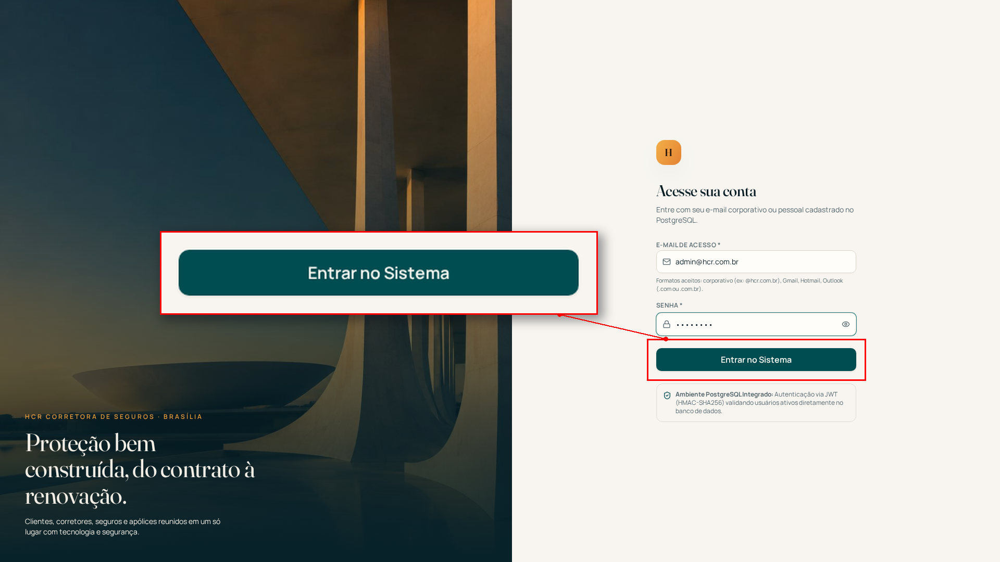

---

### Passo 02 — Painel Principal (Dashboard Operacional)

1. Assim que a autenticação é concluída, o sistema carrega a aba **Painel** (`DashboardTab`).
2. Na faixa superior, quatro cartões consolidam os indicadores em tempo real do PostgreSQL:
   - **Clientes:** Total de segurados cadastrados.
   - **Apólices ativas:** Quantidade de contratos vigentes ou em renovação.
   - **Prêmios sob gestão:** Soma financeira dos prêmios anuais ativos.
   - **Cotações em aberto:** Total de solicitações em andamento e alertas pendentes.
3. Abaixo dos indicadores, o painel exibe as **Apólices com vencimento nos próximos 30 dias**, as **Cotações recentes**, o **Catálogo de seguros** e os **Alertas do sistema**.
4. No canto superior direito do painel, utilize os botões de ação rápida **"Nova cotação"** ou **"Cadastrar cliente"** (destacado na lupa) para iniciar fluxos operacionais imediatamente.

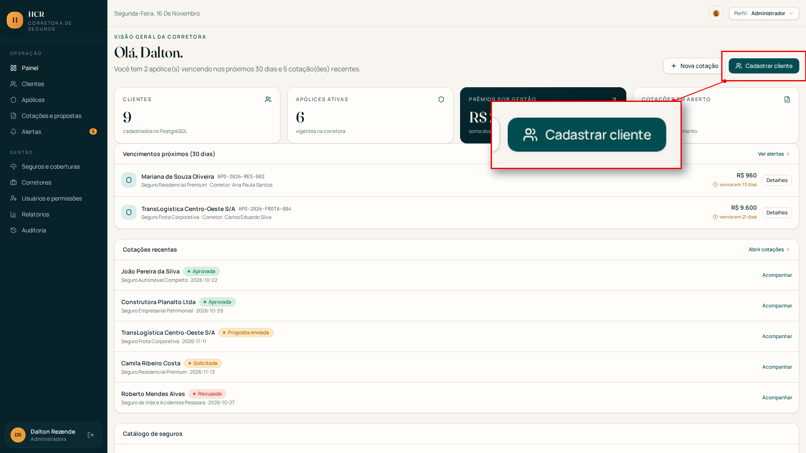

---

### Passo 03 — Módulo de Clientes (Busca, Filtros PF/PJ e Listagem)

1. No menu lateral esquerdo, na seção **Operação**, clique em **"Clientes"**.
2. Utilize a barra de pesquisa para localizar segurados instantaneamente por **nome, razão social, CPF/CNPJ, e-mail ou código identificador**.
3. Refine a listagem utilizando o seletor de tipo (**Todos os tipos**, **Pessoa física** ou **Pessoa jurídica**) e o filtro por **Corretor responsável**.
4. Para incluir um novo segurado na base, clique no botão **"Cadastrar cliente"** no canto superior direito da tela.

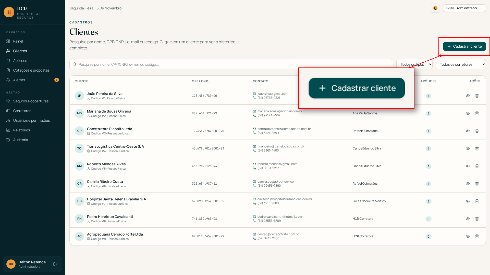

---

### Passo 04 — Cadastro de Novo Cliente (PF ou PJ)

1. Ao clicar em **"Cadastrar cliente"**, o modal de cadastro é exibido.
2. Selecione o **Tipo de Pessoa**:
   - **Pessoa Física (CPF):** Exige exatamente 11 dígitos numéricos.
   - **Pessoa Jurídica (CNPJ):** Exige exatamente 14 dígitos numéricos.
3. Preencha o **Nome Completo / Razão Social**, **E-mail**, **Data de Nascimento / Fundação**, **Telefone** e selecione o **Corretor Responsável**.
4. Na seção **Endereço Principal**, informe logradouro, número, bairro, cidade e UF.
5. Clique no botão **"Salvar cliente"** (destacado na lupa) para persistir o cliente e seus vínculos de telefone/endereço via `POST /api/clientes`.

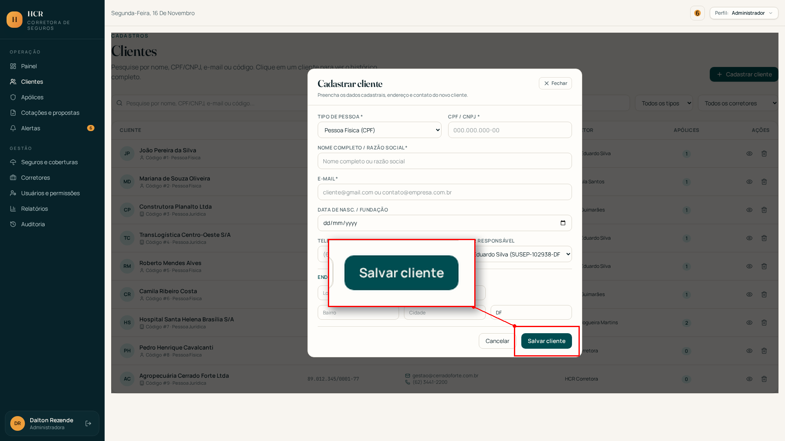

---

### Passo 05 — Histórico Completo do Cliente (Visão 360°)

1. Na tabela de clientes, clique sobre qualquer linha ou no ícone de visualização (**"Ver histórico completo"**) na coluna **Ações**.
2. O sistema consulta `GET /api/clientes/{id}/historico` e abre o dossiê completo do segurado contendo:
   - **Dados de Contato** (e-mail e telefones cadastrados);
   - **Endereço Cadastrado** completo;
   - **Apólices Contratadas** com número da apólice, situação, vigência e valor do prêmio;
   - **Cotações Solicitadas** e respectivas situações comerciais.
3. Após consultar as informações, clique no botão de fechar no canto superior direito do modal (destacado na lupa) para retornar à listagem.

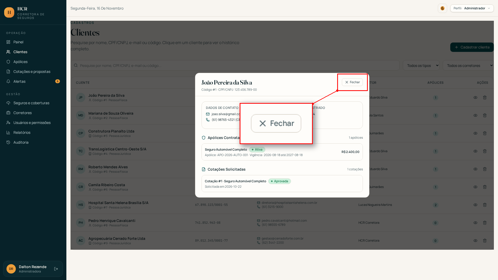

---

### Passo 06 — Módulo de Apólices e Contratos

1. No menu lateral esquerdo, clique em **"Apólices"**.
2. Esta tela apresenta todos os contratos securitários emitidos pela corretora, exibindo número da apólice, segurado titular, corretor responsável, período de vigência, situação (`ATIVA`, `EM_RENOVACAO`, `CANCELADA`, `VENCIDA`), valor do prêmio anual e progresso de quitação das parcelas.
3. Utilize a barra de busca ou os seletores **Todas as situações** e **Todos os seguros** para filtrar a carteira.
4. Para emitir um novo contrato diretamente, clique no botão **"Registrar contratação"** (destacado na lupa).

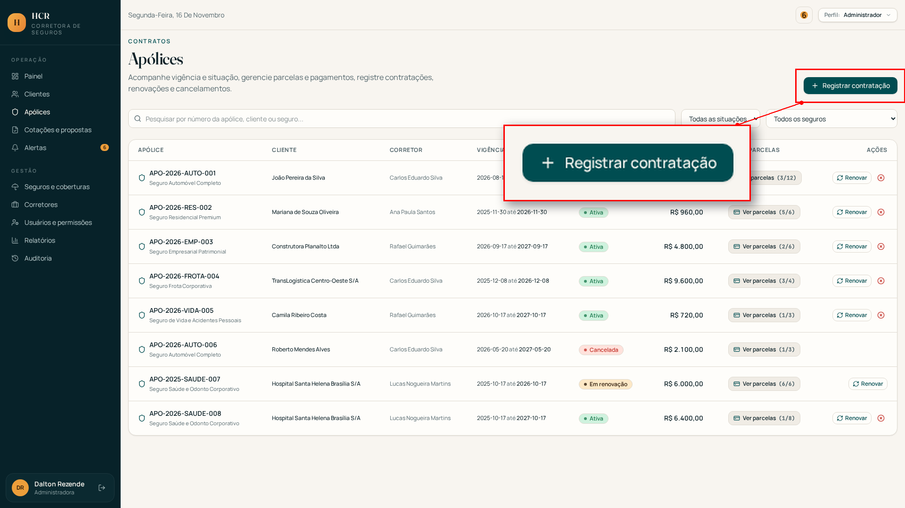

---

### Passo 07 — Registro de Contratação e Emissão de Apólice

1. No modal **"Registrar contratação"**, selecione o **Cliente** titular, o produto de **Seguro** (o prêmio anual base é preenchido automaticamente, podendo ser ajustado) e o **Corretor Responsável**.
2. O campo **Número da Apólice** é opcional (caso deixado em branco, o back-end gera automaticamente um código único padronizado).
3. Defina as datas de **Início da Vigência** e **Término da Vigência** (a data final deve ser obrigatoriamente posterior à inicial).
4. Escolha o **Plano de Pagamento** (`1x à vista`, `3x`, `6x`, `10x` ou `12x parcelas mensais`).
5. Clique em **"Gerar apólice"** (destacado na lupa) para emitir o contrato e gerar automaticamente todo o cronograma de parcelas na tabela `parcela_pagamentos`.

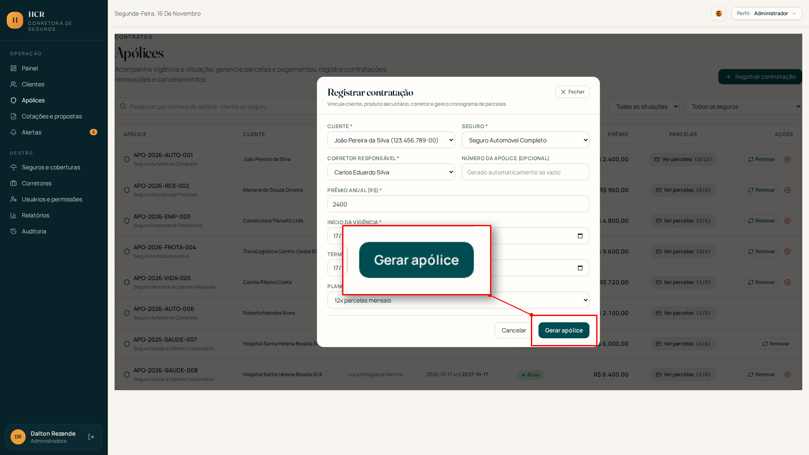

---

### Passo 08 — Gestão de Parcelas e Baixa de Pagamentos

1. Na listagem de apólices, localize a coluna **Parcelas** e clique no botão **"Ver parcelas"** da apólice desejada.
2. O modal financeiro apresenta no topo o resumo de **Total de Parcelas**, montante de **Pagas** (em verde) e saldo de **Não Pagas** (em âmbar), além de filtros rápidos (**Todas**, **Não pagas**, **Pagas**).
3. Para registrar o pagamento de uma parcela pendente:
   - Selecione a **Forma de Pagamento** no menu suspenso da parcela (`PIX`, `Boleto Bancário`, `Cartão de Crédito`, `Cartão de Débito`, `Transferência / TED` ou `Dinheiro`);
   - Clique no botão verde **"Marcar Pago"** (destacado na lupa).
4. Caso uma parcela tenha sido baixada por engano, é possível reabri-la clicando em **"Marcar Não Pago"**.

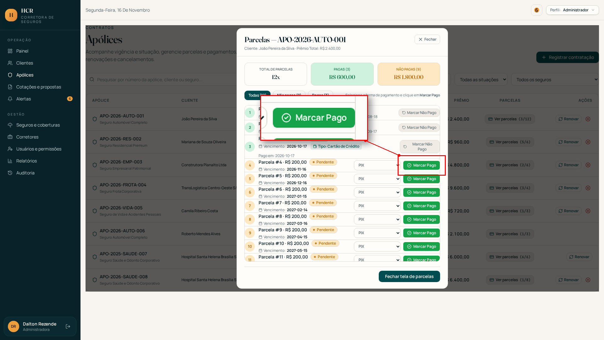

---

### Passo 09 — Renovação Contratual de Apólice

1. Na coluna **Ações** de uma apólice ativa ou em renovação, clique no botão **"Renovar"**.
2. O modal **"Renovar apólice"** preserva automaticamente a **Data de Início Original (1º Contrato)** conforme a regra de negócio da corretora, vinculando o histórico por meio de `id_apolice_anterior`.
3. Informe a **Nova Data de Término da Vigência**, ajuste o **Novo Prêmio Anual (R$)** e escolha o **Parcelamento da Renovação**.
4. Clique em **"Confirmar renovação"** (destacado na lupa) para efetivar a nova apólice e gerar suas respectivas parcelas.

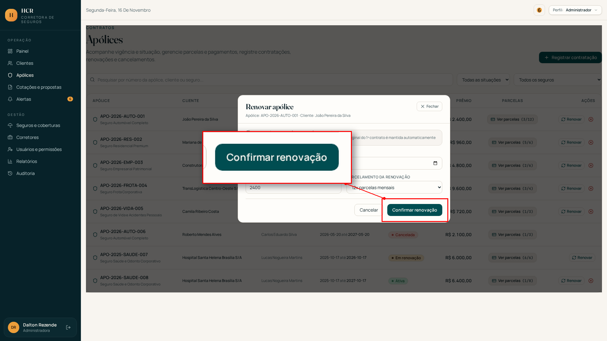

---

### Passo 10 — Módulo de Cotações e Propostas Comerciais

1. No menu lateral esquerdo, acesse **"Cotações e propostas"**.
2. Este módulo gerencia todo o funil pré-contratual da corretora: desde o registro da solicitação de cotação pelo cliente até a elaboração e resposta da proposta comercial.
3. Para iniciar uma nova simulação de risco, clique no botão **"Nova cotação"** (destacado na lupa), selecione o cliente, o ramo de seguro e descreva os dados do bem/risco segurado.

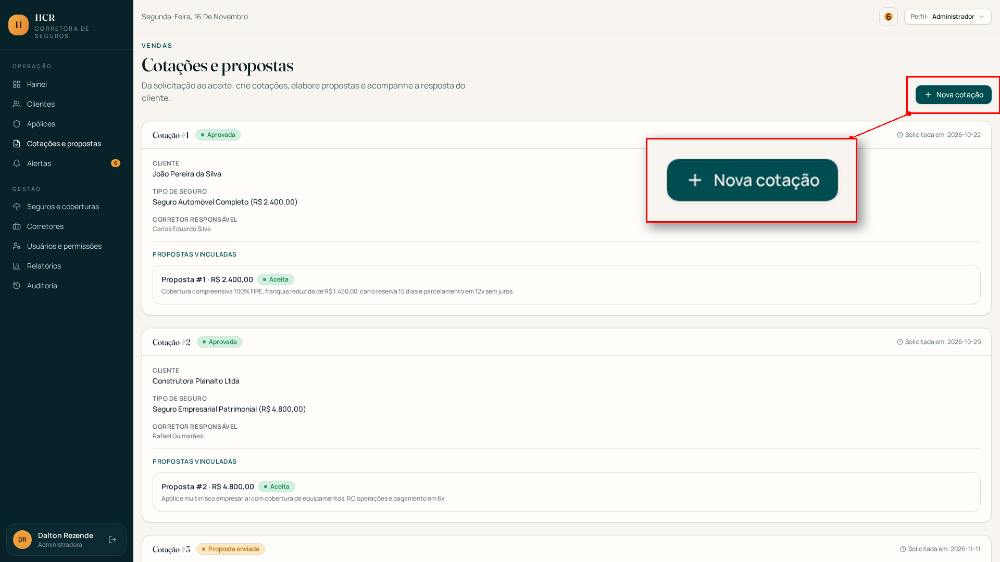

---

### Passo 11 — Aceite de Proposta e Conversão Automática em Apólice

1. Cada cartão de cotação exibe as **Propostas Vinculadas** ou o botão **"Elaborar proposta"** (quando ainda não há proposta comercial cadastrada).
2. Quando uma proposta encontra-se com status `PENDENTE`, ficam disponíveis os botões de decisão comercial:
   - **"Aceitar (Gera apólice)"** (destacado na lupa): Ao clicar neste botão, o sistema aprova a proposta (`ACEITA`), atualiza a cotação para `APROVADA` e **emite automaticamente a apólice e suas parcelas no PostgreSQL**.
   - **"Recusar"**: Registra a recusa formal da proposta mantendo o histórico comercial.

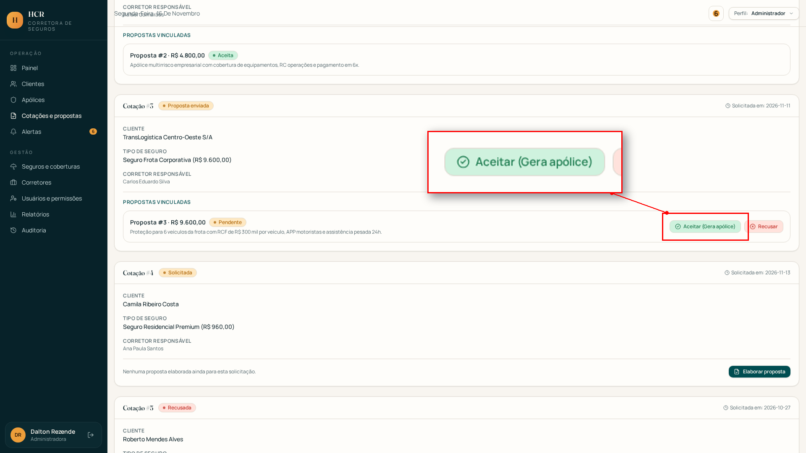

---

### Passo 12 — Monitoramento de Alertas e Vencimentos (30 dias)

1. No menu lateral esquerdo, clique em **"Alertas"** (ou no ícone de sino no cabeçalho superior).
2. A tela é dividida em duas seções operacionais:
   - **Vencimentos próximos (Janela de 30 dias):** Lista automaticamente todas as apólices cuja vigência encerra nos próximos 30 dias, permitindo acionar o botão **"Renovar apólice"** diretamente.
   - **Notificações e Avisos Registrados no Banco:** Exibe os alertas operacionais da tabela `notificacao_alerta`, permitindo marcá-los como lidos (`PUT /api/alertas/{id}/lido`).
3. Para registrar um lembrete ou notificação manual para qualquer usuário da equipe, clique no botão **"Novo alerta"** (destacado na lupa).

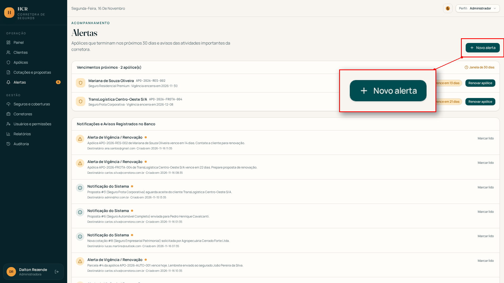

---

### Passo 13 — Catálogo de Seguros e Coberturas

1. Na seção **Gestão** do menu lateral, clique em **"Seguros e coberturas"**.
2. O catálogo exibe todos os produtos securitários oferecidos pela HCR Corretora (Automóvel, Residencial, Vida, Empresarial, Frota e Saúde Corporativa), apresentando o prêmio base anual e a lista de **Coberturas** com seus respectivos limites máximos de indenização (LMI).
3. Em cada cartão de produto, você pode clicar em **"+ Adicionar"** para vincular novas coberturas específicas ao seguro.
4. Para cadastrar um novo produto securitário no portfólio, clique no botão **"Novo seguro"** (destacado na lupa).

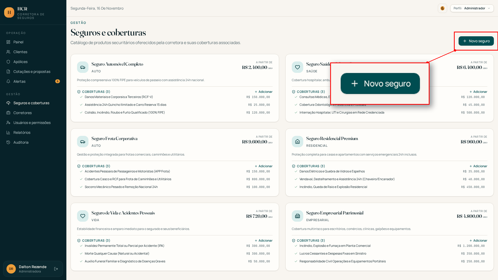

---

### Passo 14 — Gestão de Corretores Autorizados (SUSEP)

1. No menu lateral esquerdo, em **Gestão**, clique em **"Corretores"**.
2. Os cartões exibem os dados profissionais de cada corretor: nome completo, código de **Registro SUSEP**, ramo de especialidade, e-mail, telefone, total de clientes atendidos, apólices ativas sob responsabilidade e botão para **Ativar/Desativar** o status operacional.
3. Para cadastrar um novo corretor autorizado na equipe, clique no botão **"Novo corretor"** (destacado na lupa).

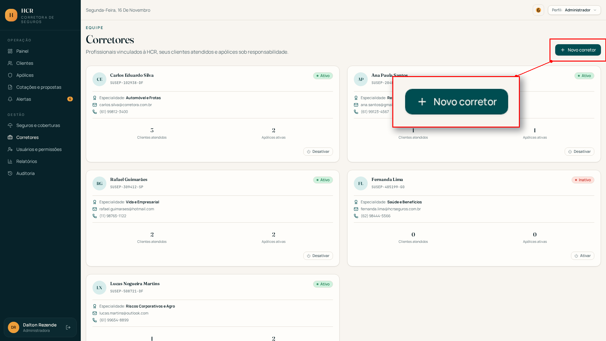

---

### Passo 15 — Gestão de Usuários, Status de Conta e Matriz RBAC

1. No menu lateral esquerdo, clique em **"Usuários e permissões"**.
2. Utilize os filtros rápidos (**Todos os usuários**, **Ativos**, **Inativos**) para inspecionar as contas de acesso cadastradas na tabela `usuario`.
3. Na coluna **Ativar / Desativar**, é possível bloquear ou liberar instantaneamente o login de qualquer usuário (`PUT /api/usuarios/{id}/status`). Usuários com status `INATIVO` têm o login bloqueado imediatamente na autenticação JWT.
4. Na parte inferior da página, consulte a **Matriz de Permissões por Perfil** (`Administrador`, `Corretor` e `Cliente`).
5. Para criar uma nova credencial de acesso, clique no botão **"Novo usuário"** (destacado na lupa).

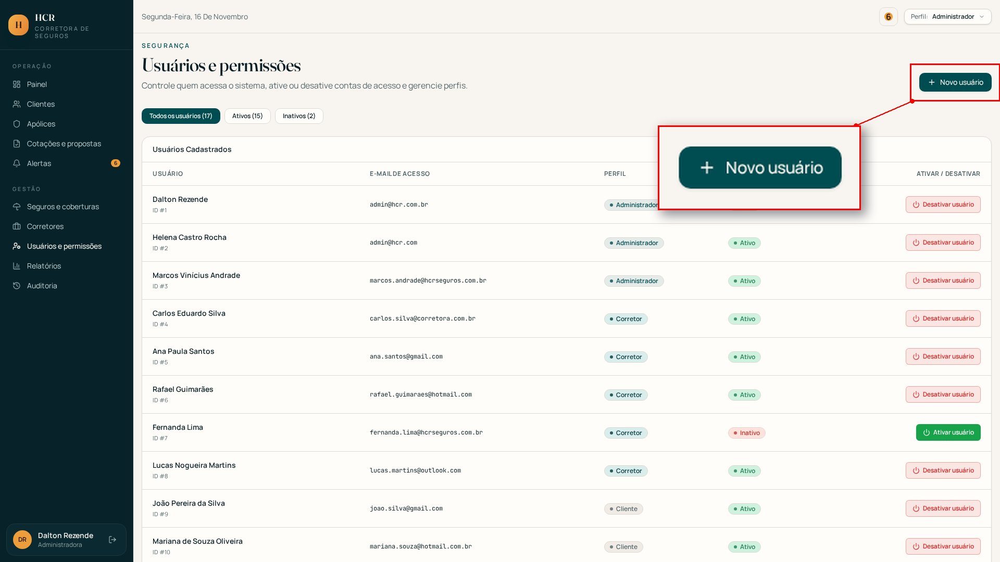

---

### Passo 16 — Relatórios Gerenciais e Exportação CSV

1. No menu lateral esquerdo, clique em **"Relatórios"**.
2. A tela consolida os indicadores executivos da corretora:
   - **Carteira ativa (R$):** Volume total de prêmios vigentes;
   - **Clientes:** Total de segurados e proporção de Pessoas Jurídicas;
   - **Apólices:** Total de contratos emitidos e vigentes;
   - **Conversão de propostas (%):** Taxa de propostas aceitas sobre respondidas.
3. Analise os gráficos comparativos de **Carteira por corretor**, **Apólices por situação** e **Prêmios ativos por seguro**.
4. Para extrair a base consolidada de apólices para análise externa em planilhas (Excel, Google Sheets ou BI), clique no botão **"Exportar CSV"** (destacado na lupa).

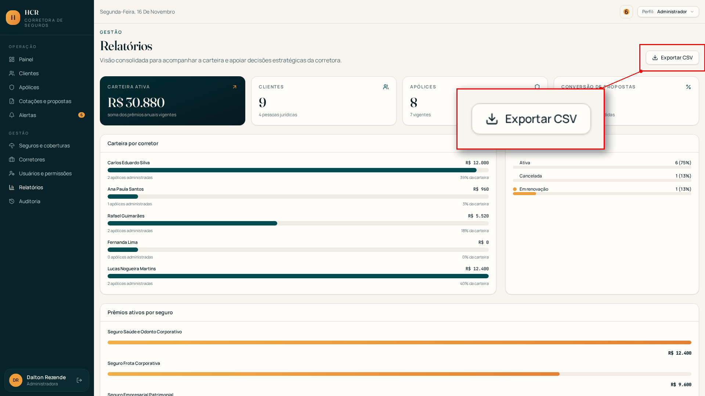

---

### Passo 17 — Trilha de Auditoria (Audit Trail) e Rastreabilidade

1. No menu lateral esquerdo, acesse **"Auditoria"**.
2. Todas as operações sensíveis realizadas no sistema (criação, atualização, renovação, baixa de pagamento, cancelamento e alteração de status) são gravadas automaticamente na tabela `log_auditoria` com **Data e Hora**, **Ação**, **Tabela Afetada**, **E-mail do Usuário**, **IP de Origem** e **Detalhes da Operação**.
3. Utilize o campo de busca textual ou o seletor **"Todas as tabelas"** (destacado na lupa) para filtrar os eventos por entidade do banco de dados (`apolice`, `cliente`, `cotacao`, `proposta`, `usuario`, `corretor`, `seguro`).

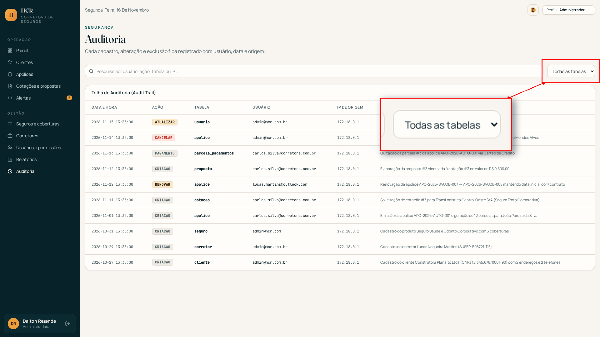

---

### Passo 18 — Encerramento de Sessão Seguro (Logout)

1. No cabeçalho superior direito, você também pode alternar a visualização rápida de perfil no seletor **"Perfil: Administrador / Corretor / Cliente"** para testar a experiência de cada papel.
2. Para encerrar sua sessão com segurança e invalidar o token JWT armazenado no navegador, localize o card do usuário no rodapé inferior esquerdo da barra lateral e clique no botão **"Sair"** (ícone de logout destacado na lupa).

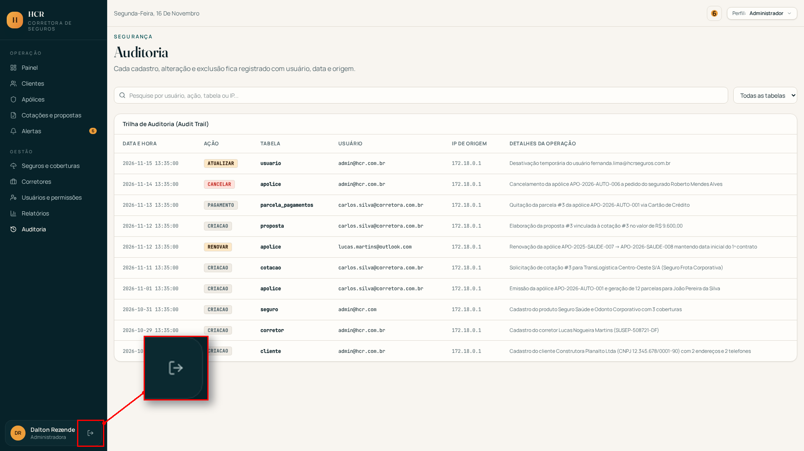

---

## 4. Atualização Automatizada das Capturas do Manual

O gerador de imagens anotadas deste manual encontra-se isolado em `tools/manual_generator/`. Sempre que houver evoluções visuais nas telas React, basta executar:

```bash
./tools/manual_generator/.venv/bin/python tools/manual_generator/generate_manual_images.py
```

Consulte o arquivo [`tools/manual_generator/README.md`](../tools/manual_generator/README.md) para mais detalhes sobre parâmetros e configuração do ambiente virtual.
